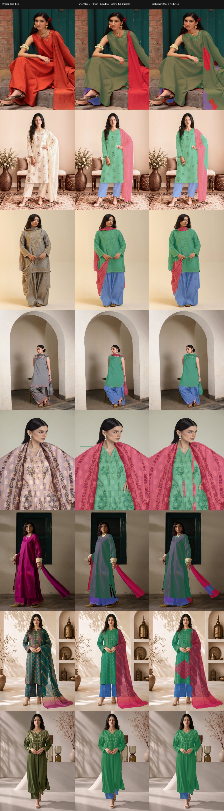
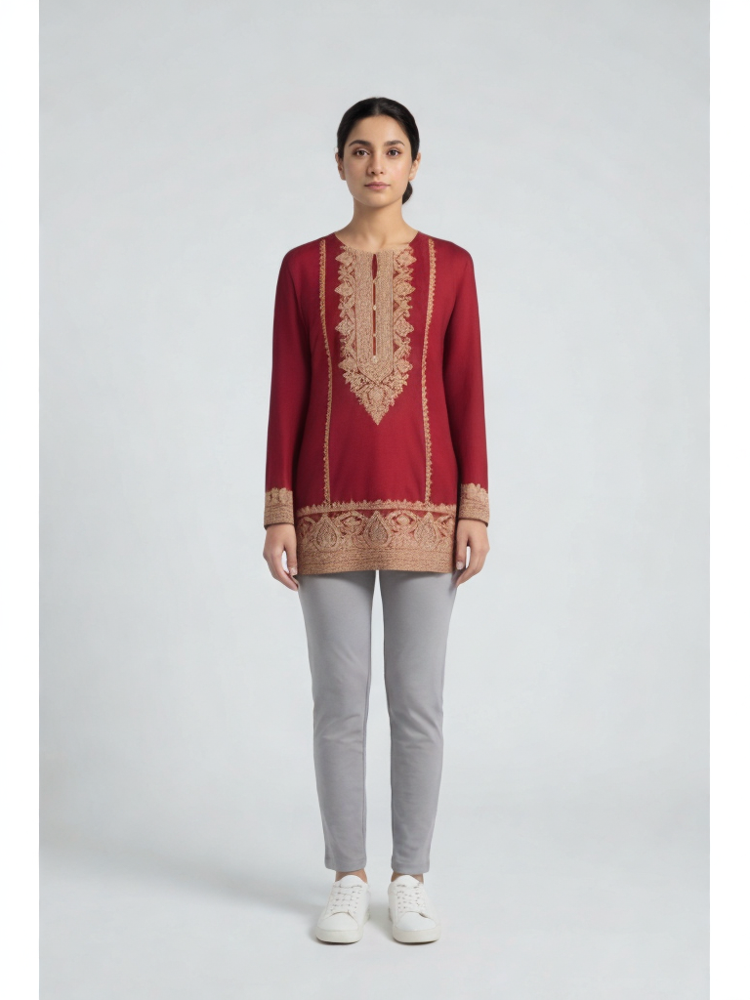
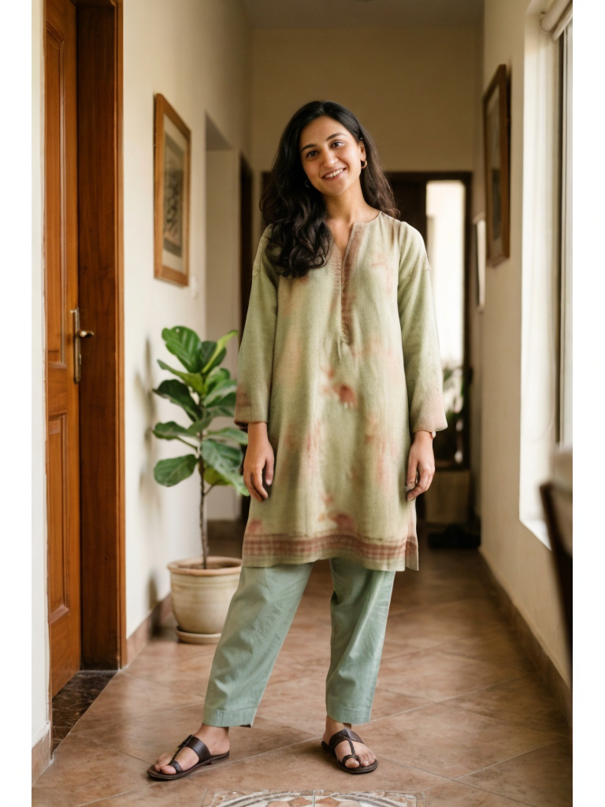
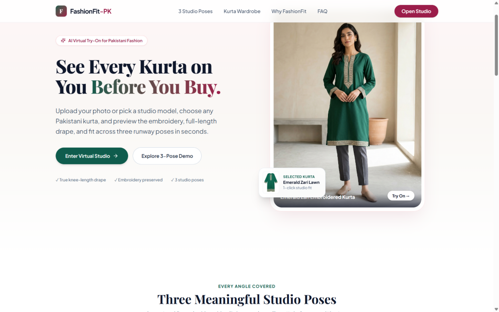

# FashionFit-PK — Culturally-Aware AI Virtual Try-On for Pakistani Ethnic Wear

[](#)
[](https://fashionfit-pk.vercel.app/)
[](#)

**FashionFit-PK** is a full-stack and research-driven Virtual Try-On (VTON) platform built specifically for Pakistani ethnic wear (3-piece prêt, dupattas, kids' ethnic wear, and flared wedding lehengas). It combines a **custom 4-class Gold SegFormer-B2 parser** (explicitly isolating `dupatta`), a **Pakistani-adapted CatVTON + LoRA generator**, and a **novel A-line dilated masking algorithm** for flared bridal silhouettes.

---

## Live Cloud Deployment
* **Production Web App:** [https://fashionfit-pk.vercel.app/](https://fashionfit-pk.vercel.app/)

---

## Empirically Measured Results (Zero-Leakage Unseen-SKU Splits)

### 1. 4-Class Pakistani Semantic Segmentation (Gold Held-Out Test Set)
| Class | Baseline (`segformer_b2_clothes`) | **FashionFit-PK Gold SegFormer-B2** | Gain |
|---|---:|---:|---:|
| `other` | 95.72% | **96.81%** | +1.09% |
| `kurta_kameez` | 74.31% | **84.29%** | +9.98% |
| `bottom` | 36.98% | **69.43%** | **+32.45%** |
| `dupatta` | 3.12% | **55.82%** | **+52.70% (17.9x)** |
| **Overall mIoU** | **52.53%** | **76.59%** | **+24.06%** |

### 2. Pakistani Virtual Try-On Generation (Held-Out Unseen-SKU Set, $N = 50$)
| Metric | Zero-Shot CatVTON | **CatVTON + Pakistani LoRA** | Improvement |
|---|---:|---:|---:|
| **FID** ($\downarrow$) | 120.16 | **95.28** | **-20.7%** |
| **LPIPS** ($\downarrow$) | 0.1869 | **0.1531** | **-18.1%** |
| **CLIP-I** ($\uparrow$) | — | **0.9488** | High fidelity |

---

## Industry-Standard Repository Structure

```text
fyp26-fashionfit-pk/
├── .github/workflows/ci.yml             # Automated CI pipeline (lint + unit tests + profiler)
├── bin/                                 # Executable shell, health, profiling & isolated push scripts
├── docs/                                # Formal FYP I Report, Architecture, Test Cases, Missing Semester, PPTX
├── lib/                                 # Core Python ML library (4-class masking, flared lehenga dilation, IoU/SKU metrics)
├── research/                            # Reproducible FYP2 & V3 Jupyter notebooks + visual proof results
├── src/                                 # Full-stack application (frontend/, backend/, api/, colab_server/)
├── tests/                               # Automated unittest suite (masking, metrics, repo/API contracts)
├── Makefile                             # Standardized automation targets (make verify)
└── .env.example                         # Clean environment variable template (zero committed secrets)
```

---

## Quick Verification (MIT Missing Semester Applied)

```bash
# Run syntax checks, automated unit tests, and mask latency/memory profiler
make verify

# Or directly via shell script
bash bin/run_tests.sh
python bin/profile_inference.py
```

---

## Visual Proof Gallery (Empirical Evidence)

### 1. Gold 4-Class SegFormer-B2 Predictions (Held-Out Pakistani Test Set)


### 2. Live End-to-End Virtual Try-On & Cloud Deployment QA
| Best-Case Live Try-On | Mid-Case Live Try-On | Live Vercel Cloud App (QA Verified) |
|---|---|---|
|  |  |  |

*(Additional dupatta segmentation proofs, baseline-vs-adapted cutout overlays, and worst-case stress tests are archived in `research/results/dupatta_proofs/` and `research/results/live_tryon_results/`.)*

---

## ITU FoS FYP I Compliance & End-to-End Traceability Checklist
- [x] **Complete Chronological Progress Log:** [CHANGELOG.md](CHANGELOG.md) (Phase 1 $\rightarrow$ v1.1.0-fyp1)
- [x] **Complete Formal Documentation:** [docs/FYP1_COMPLETE_DOCUMENTATION.md](docs/FYP1_COMPLETE_DOCUMENTATION.md) (Standard + Research + Math + 5-Project Survey)
- [x] **Architecture & Detailed Design:** [docs/ARCHITECTURE.md](docs/ARCHITECTURE.md)
- [x] **Supervisor Questions & V3 Extension Plan:** [docs/SUPERVISOR_QUESTIONS_AND_V3_EXTENSION.md](docs/SUPERVISOR_QUESTIONS_AND_V3_EXTENSION.md) (Data Sources, Kids Wear, Cross-Age, Flared Lehengas)
- [x] **AI Usage Transparency & Data Ethics:** [docs/AI_USAGE_AND_ETHICS.md](docs/AI_USAGE_AND_ETHICS.md)
- [x] **Manually Reviewed Test Cases & E2E Harness:** [docs/TEST_CASES.md](docs/TEST_CASES.md) + `tests/` + `tests/e2e/run_live_tryon_test.py`
- [x] **MIT Missing Semester Applied:** [docs/MISSING_SEMESTER_APPLIED.md](docs/MISSING_SEMESTER_APPLIED.md) (`bin/`, `Makefile`, CI, profiler, isolated Git)
- [x] **Machine-Readable & LaTeX Benchmarks:** [research/results/measured_benchmarks.json](research/results/measured_benchmarks.json) & [research/results/paper_tables.tex](research/results/paper_tables.tex)
- [x] **Defense Slides:** [docs/FashionFit_PK_FYP1_Defense_Presentation.pptx](docs/FashionFit_PK_FYP1_Defense_Presentation.pptx)
- [x] **Cloud Deployment:** [https://fashionfit-pk.vercel.app/](https://fashionfit-pk.vercel.app/)
- [x] **Dedicated Project Account:** Owned by `fyp26fashionfitpk` (`fyp26_fashionfitpk@gmail.com`)
