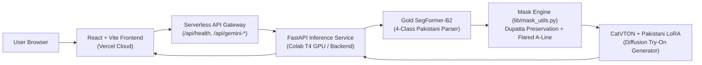
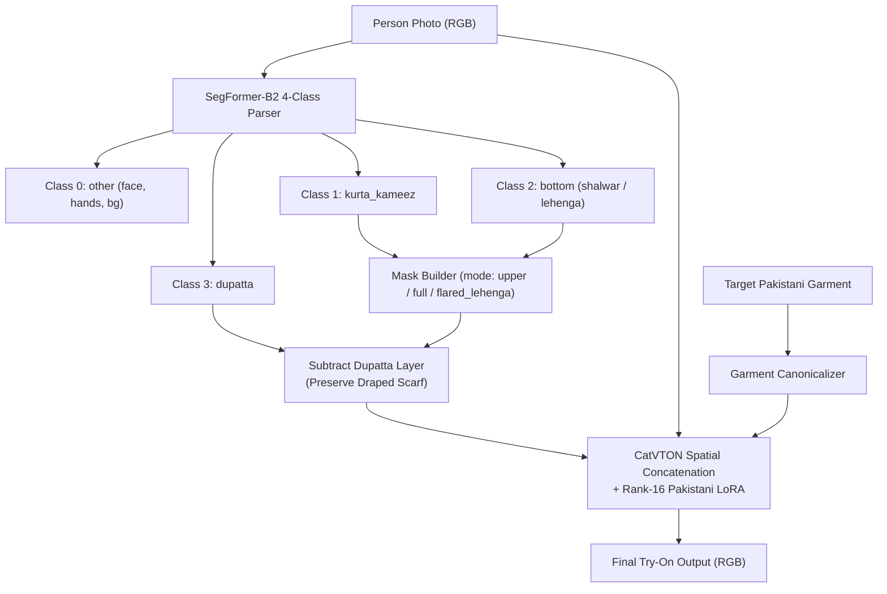

# System Architecture & Detailed Design — FashionFit-PK

## 1. High-Level System Architecture

## 2. Detailed ML Inference Pipeline

## 3. Repository Directory Architecture (Industry Standard)

| Directory | Responsibility |
|---|---|
| `src/` | Production full-stack source (`frontend/`, `backend/`, `api/`, `colab_server/`) |
| `lib/` | Reusable Python ML core (`mask_utils.py`, `metrics.py`) |
| `bin/` | Executable shell & profiling scripts (MIT Missing Semester) |
| `docs/` | Formal FYP I documentation, architecture, test cases, defense PPTX |
| `tests/` | Automated unit and contract tests (`unittest`) |
| `research/` | Reproducible FYP2 & V3 training/evaluation notebooks and empirical artifacts |
| `.github/workflows/` | Automated Continuous Integration (`ci.yml`) |
