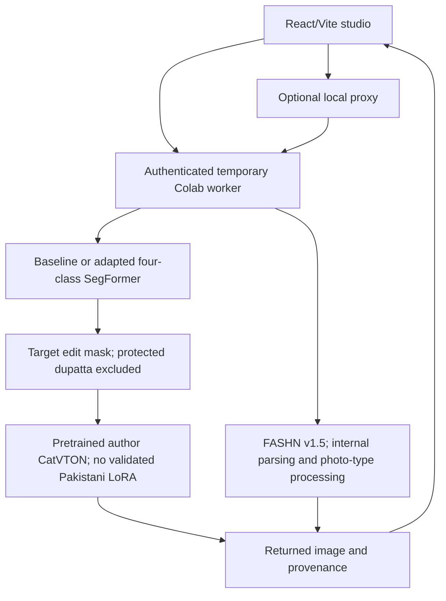

# Current architecture — FashionFit-PK

The native FASHN masking comparison is a separate experiment. V4 masks are not passed into FASHN. Model-worn donors and visible-fabric pseudo-cutouts are distinct reference types. The live smoke helper builds CatVTON's pseudo-reference from a reviewed class-1 source mask and records it; FASHN receives the original donor photo. No hidden fabric is reconstructed.

One worker thread owns bounded admitted jobs. Timeout/disconnect does not imply GPU cancellation. The live notebook allows 1800 seconds including loading; clients wait 1860 seconds. Competing VTON models are evicted on switch. Tokens remain session-private.

The browser stores the completed run's settings with its result; request identity blocks stale updates. Gemini and synthesized additional views stay disabled by default. Back-view fidelity is unproven.

Frozen inputs, runtime/model identities, per-output sidecars and separate human review files provide traceability. Full adult bridal capability remains unvalidated. Old architecture diagrams are archived under legacy_unverified and are superseded.
